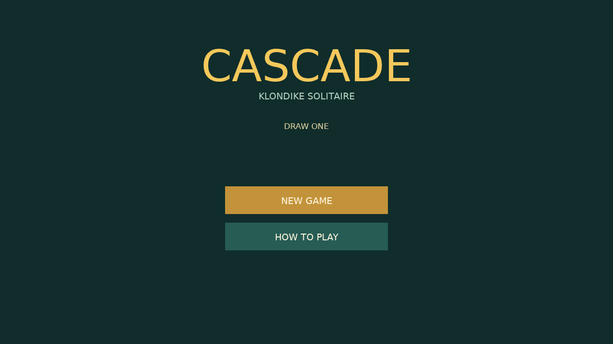

# Cascade

Cascade is a calm, tactile game of Draw One Klondike on a deep green felt table. Build each foundation from ACE through KING while uncovering the hidden cards in the seven columns.

Turn the STOCK one card at a time, move alternating-color runs down the tableau, and fill an empty column only with a KING. Drag with a mouse or finger, or DOUBLE-CLICK a playable card to send it home.

When the final card reaches a foundation, the table erupts. All fifty-two cards launch from their foundations, bounce across the felt, and leave a painted trail behind them before the next deal begins.

